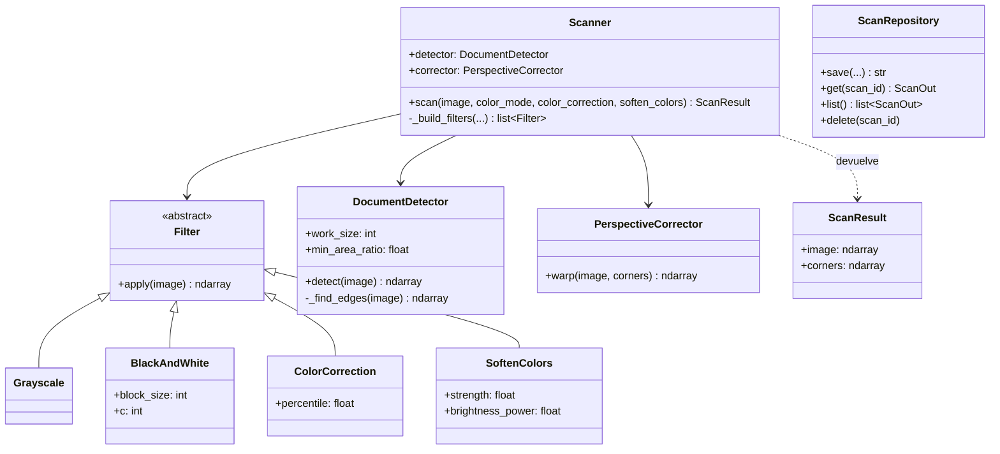
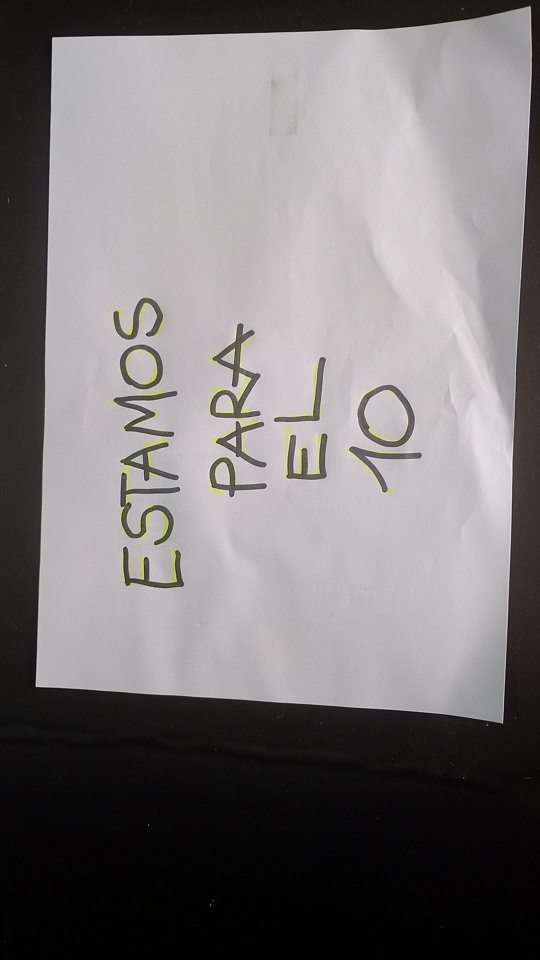
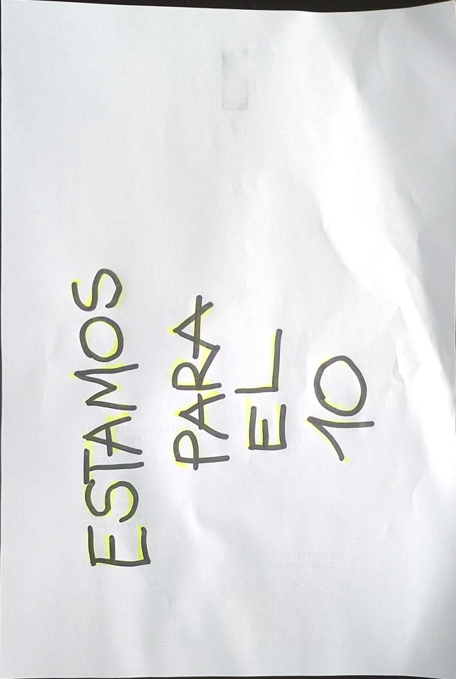
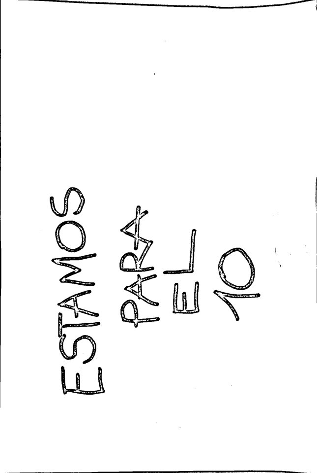

# TP 2 — Escáner de documentos

La consigna completa está en [`enunciado.html`](enunciado.html) (abrilo en el navegador).

## Cómo correrlo

```bash
cd backend
python -m venv .venv
source .venv/bin/activate        # Windows: .venv\Scripts\activate
pip install -r requirements.txt
uvicorn app.main:app --reload --port 8765
```

- Frontend: http://localhost:8765
- Documentación de la API: http://localhost:8765/docs

## Línea de comandos

```bash
cd backend
python -m docscan foto.jpg escaneo.png --color-mode grayscale --soften-colors 0.5
```

## Tests de aceptación

```bash
cd backend
pytest tests/test_contract.py -v
```

## Integrantes

- Abigail Nina
- Gastón Ramírez
- Pablo Speranza
- Rocío Vázquez

## Tests propios

Además de los tests de aceptación, agregamos tests propios del core, del almacenamiento y con fotos reales:

| Archivo | Qué prueba |
| --- | --- |
| `tests/test_filters.py` | Los 4 filtros: gris, blanco y negro, corrección de color y aclarado de colores |
| `tests/test_core.py` | El orden de las esquinas, el detector, la perspectiva y el escáner |
| `tests/test_storage.py` | Guardar, leer, listar y borrar escaneos, y rechazar ids inválidos |
| `tests/test_real_photos.py` | Fotos reales de `tests/photos/`: 2 con documento y 2 sin documento |

Para correr todos los tests:

```bash
cd backend
pytest -v
```
## Diagrama de clases



- `docscan` (el core) tiene todas las clases menos `ScanRepository`, que es de la API (`app/storage.py`).
- `Filter <|-- Grayscale` significa "Grayscale **hereda** de Filter".
- `Scanner --> DocumentDetector` significa "Scanner **usa** un DocumentDetector".

## Decisiones de diseño

### El core no depende de la API
Todo el procesamiento de imágenes está en `docscan`, que no importa nada de FastAPI. Recibe una imagen y devuelve otra. Por eso se puede usar desde la API, desde la línea de comandos (`python -m docscan`) o desde cualquier programa. El almacenamiento es de la API (`app/storage.py`), no del core.

### Cómo detectamos el documento
`DocumentDetector` trabaja sobre una copia reducida de la foto (600 px de lado mayor) para ganar velocidad:
1. Pasa a gris y aplica un desenfoque gaussiano para borrar ruido y textura de la mesa.
2. Busca bordes con Canny.
3. Cierra los huecos de los bordes con un *closing* (dilatación + erosión).
4. Busca los contornos externos y los ordena de mayor a menor área.
5. Simplifica cada contorno con `approxPolyDP` (2 % del perímetro) y se queda con el primero que tenga 4 vértices, sea convexo y ocupe al menos el 15 % de la foto.
6. Reescala las esquinas al tamaño original y las ordena: la superior izquierda tiene la menor suma x + y, la inferior derecha la mayor, y la resta y − x separa las otras dos.

Si no encuentra el documento, lanza `DocumentNotFound` con un mensaje que explica cómo sacar una mejor foto. Todos los parámetros son atributos con valor por defecto, no números sueltos.

### Cómo enderezamos la hoja
`PerspectiveCorrector` calcula el ancho como el mayor entre los bordes superior e inferior, y el alto como el mayor entre los bordes izquierdo y derecho. Así la hoja conserva sus proporciones y no pierde resolución. Después usa `getPerspectiveTransform` y `warpPerspective`, con las esquinas de origen y destino en el mismo orden para que no salga espejada.

### Cómo corregimos el color
- **Corrección de color:** balance de blancos por canal. Se toma el percentil 95 de cada canal como el color del papel y se estira cada canal para que llegue a 255. Usamos el percentil y no el máximo para no depender de un solo píxel muy brillante.
- **Blanco y negro:** umbral adaptativo (`adaptiveThreshold`), que compara cada píxel con sus vecinos. Un umbral fijo pintaría de negro las zonas con sombra.
- **Aclarar colores fuertes:** en HSV, el peso del aclarado es `fuerza × S × V³`. Elevamos el brillo al cubo para **no borrar trazos oscuros de color**, como la birome azul: los colores muy brillantes (resaltador, sello) se aclaran, y los oscuros casi no cambian.

### Cómo evitamos los if/elif
- Todos los filtros heredan de la clase abstracta `Filter` y tienen el mismo método `apply(image)`. El `Scanner` arma una lista de filtros y los aplica en un `for` **sin saber cuál es cuál** (polimorfismo).
- El modo de color se elige con un diccionario (`COLOR_MODE_FILTERS`) que asocia cada nombre con su clase. Para agregar un filtro nuevo, como sepia, alcanza con crear la clase y agregarla al diccionario, sin tocar los filtros existentes.
- El `Scanner` recibe el detector y el corrector en su constructor, así se puede cambiar el algoritmo de detección sin tocar el resto.

### Almacenamiento seguro
`ScanRepository` guarda cada escaneo como `<id>.png`, `<id>-original.<ext>` y `<id>.json`. El id se genera con `uuid4`, nunca con el nombre del usuario, y la extensión del original sale del formato real de la imagen. Antes de armar una ruta, el id se valida: un id como `../config` se rechaza.

### Limitaciones conocidas
- Si la hoja ocupa toda la foto y no se ven sus bordes, no se reconoce (se informa el error).
- En blanco y negro, una zona negra muy grande queda hueca, porque el umbral adaptativo compara cada píxel con sus vecinos.
- Si la hoja está girada en la foto, el escaneo sale girado: la orientación automática es un extra que no implementamos.

## Ejemplo antes / después

Foto real sacada con el celular (`tests/photos/hoja_resaltador.jpg`), escaneada con las opciones por defecto y en blanco y negro:

| Antes (foto) | Después (color) | Después (blanco y negro) |
| --- | --- | --- |
|  |  |  |

El escáner encontró la hoja, la enderezó, recortó la mesa y dejó el papel blanco. En blanco y negro, el texto queda nítido.